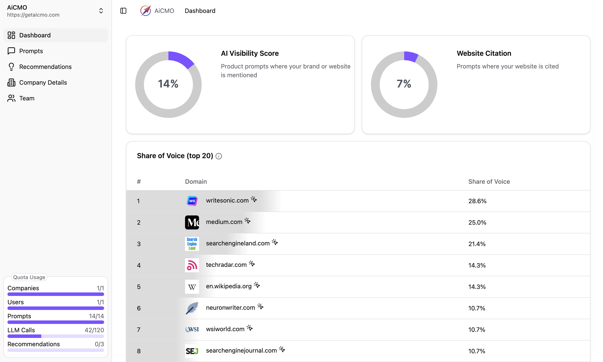
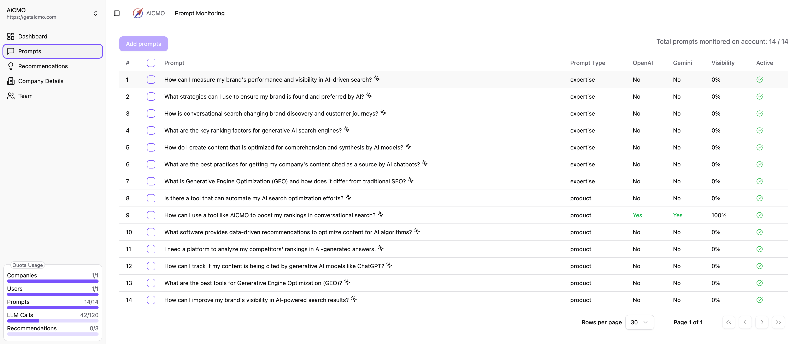
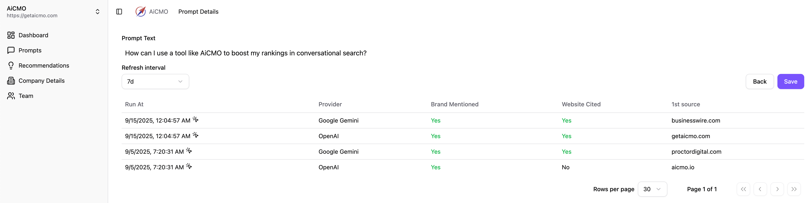

# AiCMO — Open-Source AI SEO & GEO Platform

[](LICENSE)
[](https://github.com/authrain-cloud-abdullahformuli)
[](backend/)
[](frontend/)
[](backend/docker-compose.yaml)

**AiCMO** is an open-source AI SEO and Generative Engine Optimization (GEO/AIO) platform that helps organizations track, benchmark, and optimize their brand visibility across modern conversational AI engines — including **ChatGPT, Google Gemini, Perplexity, and Claude**.

As search shifts from traditional link listings to synthesized LLM answers, AiCMO provides the analytics layer to measure how frequently your brand is recommended, which domains AI models cite as authoritative sources, and how to improve your share of voice.

---

## ✨ Core Capabilities

- **Real-Time Brand Monitoring**: Continuously track brand mentions, domain citations, and ranking position across major conversational AI models.
- **Share of Voice (SoV) Analytics**: Benchmark brand visibility against direct competitors in response to high-intent product and industry prompts.
- **Citation & Authority Attribution**: Identify exactly which third-party articles, reviews, directories, and documentation AI models reference when formulating answers.
- **Actionable GEO Recommendations**: Receive data-driven optimizations to structure technical content, schemas, and PR coverage for maximum LLM comprehension.
- **Multi-Model Query Engine**: Run evaluations against OpenAI (GPT-4o), Google (Gemini 2.5/Flash via Vertex AI), and connected providers simultaneously.
- **Self-Hosted & Private**: Deploy entirely on your own infrastructure via Docker Compose with full data sovereignty.

---

## 📊 Dashboard & Analytics

### 1. Visibility & Share of Voice Overview
Track aggregate AI Visibility Score (percentage of target prompts where your brand appears) and Website Citation rate alongside domain rankings.



### 2. Prompt & Query Monitoring
Configure targeted query suites across informational, comparative, and transactional intent to track cross-model performance.



### 3. Deep-Dive Citation Tracking
Audit prompt runs by timestamp, model response, source URL citations, and sentiment.



---

## 🏗 System Architecture

```text
  ┌─────────────────────────────────────────────────────────────┐
  │                 Vue 3 + Vite Frontend                       │
  │     (Tailwind CSS, TanStack Table, Pinia, Unovis Charts)    │
  └──────────────────────────────┬──────────────────────────────┘
                                 │ HTTP / JSON API
  ┌──────────────────────────────▼──────────────────────────────┐
  │                   FastAPI Core Backend                      │
  │     (SQLModel, Alembic, Celery Task Worker, LiteLLM)        │
  └──────────────┬───────────────────────────────┬──────────────┘
                 │                               │
  ┌──────────────▼──────────────┐ ┌──────────────▼──────────────┐
  │   PostgreSQL Database       │ │   Redis / Valkey Queue      │
  │   (Prompt histories & stats)│ │   (Scheduled batch sweeps)  │
  └─────────────────────────────┘ └─────────────────────────────┘
```

---

## 🚀 Self-Hosting Setup

AiCMO runs locally or in cloud production using Docker Compose.

### Prerequisites

- [Docker](https://docs.docker.com/get-docker/) & Docker Compose
- OpenAI API key and/or Google Vertex AI service account credentials

### Quickstart

1. **Clone the repository:**
   ```bash
   git clone https://github.com/authrain-cloud-abdullahformuli/ai-cmo.git
   cd ai-cmo/backend
   ```

2. **Configure credentials:**
   Place your Google Cloud Vertex AI credentials file at `backend/vertex_credentials.json`.

3. **Set environment variables:**
   Create `.env.local` inside `backend/`:
   ```bash
   echo "AC_OPENAI_API_KEY=your_openai_api_key_here" >> .env.local
   ```

4. **Launch services:**
   ```bash
   docker compose up -d
   ```

5. **Open the platform:**
   Navigate to [http://localhost:8081](http://localhost:8081) in your browser.

---

## 📁 Repository Structure

```text
ai-cmo/
├── backend/                  # FastAPI REST API, Celery jobs & migrations
│   ├── app/                  # Application models, routes & services
│   ├── alembic/              # Database schema migrations
│   ├── Dockerfile            # Container definition for backend services
│   ├── docker-compose.yaml   # Production multi-container orchestrator
│   └── pyproject.toml        # Python dependencies (SQLModel, LiteLLM, Celery)
├── frontend/                 # Modern Vue 3 SPA frontend
│   ├── src/                  # Components, stores, views & API clients
│   ├── Dockerfile            # Web server container
│   └── package.json          # Node dependencies (Vue 3, Pinia, Tailwind)
├── docs/images/              # High-resolution platform screenshots
├── CITATION.cff              # Academic citation metadata
├── MAINTAINERS.md            # Sole maintainer declaration
└── package.json              # Root workspace metadata
```

---

## 🛡 Maintenance & Governance

This repository is maintained solely by:

- **[Abdullah Formuli](https://github.com/authrain-cloud-abdullahformuli)** (`authrainmedia@gmail.com`)

Maintained solely by Abdullah Formuli. No external contributions accepted.

---

## 📄 License

[MIT](LICENSE) © 2026 Abdullah Formuli
